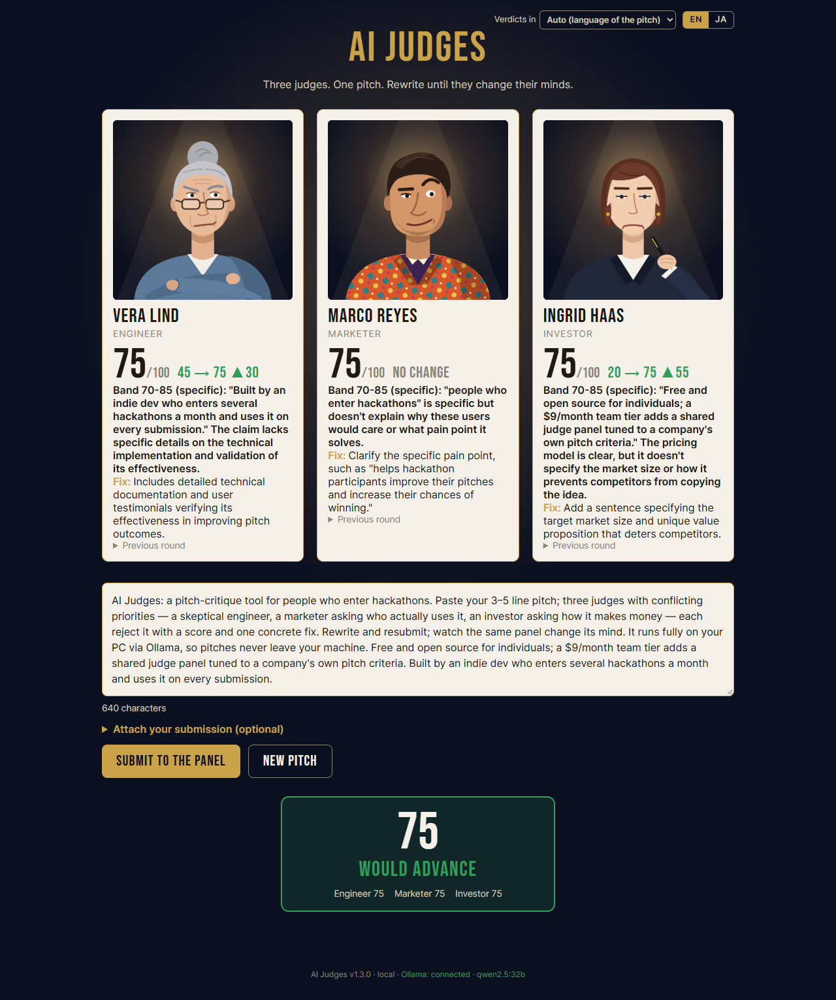

# AI Judges

Three AI judges (a skeptical engineer, a blunt marketer and an unimpressed investor) critique your 3–5 line hackathon pitch.
Each verdict quotes the exact sentence it judges, gives a score and one concrete fix. Rewrite, resubmit, and watch the panel change its mind.
Everything runs on your own PC through [Ollama](https://ollama.com): no API key, no cost, and your pitch never leaves the machine.

**Demo video:** https://youtu.be/vC5MMFTev3k



## Requirements

- **OS:** Windows, macOS or Linux, with a desktop browser (Chrome, Edge, Firefox, Safari).
- **GPU:** an NVIDIA GPU with **24 GB VRAM** for `qwen2.5:32b`, the model the judges were tuned on (RTX 3090 / 4090). With **12 GB**, `qwen2.5:14b` runs too, but its judging is noticeably weaker. A CPU alone is far too slow. Apple Silicon Macs with enough unified memory should work through Ollama, but haven't been tested.
- **Disk:** about 20 GB for `qwen2.5:32b` (about 9 GB for `qwen2.5:14b`).
- **Static server:** Python 3, or Node.js (for `npx serve`). The page can't be opened as a `file://`.

## Setup

### a. Install Ollama

Download it from https://ollama.com/download, install, then confirm in a new terminal:

```
ollama --version
```

### b. Pull the model (once)

```
ollama pull qwen2.5:32b
```

On a 12 GB GPU, pull `qwen2.5:14b` instead and change the one line at the top of `judges.js`:

```js
export const MODEL = "qwen2.5:14b";
```

### c. Recommended Ollama settings

| Variable | Value | Why |
|---|---|---|
| `OLLAMA_FLASH_ATTENTION` | `1` | Needed for the quantized cache below. |
| `OLLAMA_KV_CACHE_TYPE` | `q8_0` | Halves the context's memory, so submission review (a 12,288-token context) stays fully on a 24 GB GPU. Pitch rounds get faster too. |
| `OLLAMA_KEEP_ALIVE` | `30m` | Optional. Keeps the model loaded between rounds instead of unloading it after 5 minutes. |

Windows (Command Prompt or PowerShell):

```
setx OLLAMA_FLASH_ATTENTION 1
setx OLLAMA_KV_CACHE_TYPE q8_0
setx OLLAMA_KEEP_ALIVE 30m
```

macOS (the Ollama app):

```
launchctl setenv OLLAMA_FLASH_ATTENTION 1
launchctl setenv OLLAMA_KV_CACHE_TYPE q8_0
launchctl setenv OLLAMA_KEEP_ALIVE 30m
```

Linux, when you run `ollama serve` yourself: `export` the same three variables in the shell first. If Ollama runs as the systemd service, add them with `sudo systemctl edit ollama` (`[Service]` then `Environment="OLLAMA_FLASH_ATTENTION=1"` and so on).

**Then restart Ollama** (on Windows/macOS, quit it from the tray or menu-bar icon and start it again). The settings only reach a newly started Ollama. To check, the server log should show `OLLAMA_FLASH_ATTENTION:true` and `OLLAMA_KV_CACHE_TYPE:q8_0`. It's in `%LOCALAPPDATA%\Ollama\server.log` on Windows, `~/.ollama/logs/server.log` on macOS, and `journalctl -u ollama` for the Linux service.

### d. Get the app and start it

```
git clone https://github.com/tinycore-hisanori/ai-judges.git
cd ai-judges
```

**One click:** double-click **`start.bat`** on Windows, or run `./start.sh` on macOS/Linux. The launcher does six things, printing a status line for each:

1. Starts Ollama if it isn't running.
2. Pulls the model if it's missing.
3. Loads the model into memory so your first round isn't slow.
4. Starts the web server on port 8000 if nothing is answering there.
5. Opens http://localhost:8000.
6. If a step fails, the window stays open so you can read why.

On Windows, keep the "AI Judges server" window open while you use the app.

**Manually:**

```
python -m http.server 8000
```

(or `npx serve -l 8000`), then open **http://localhost:8000**. Use `localhost`, not `0.0.0.0` or a LAN address. Ollama only accepts browser requests from allowed origins.

The footer shows the app version and whether Ollama is reachable. It reads "Ollama: connected · qwen2.5:32b" in green when all is well, or red with what's wrong.

## Usage

**The pitch loop.** Paste a 3–5 line pitch and press **Submit to the panel**. The judges read it one after another:
- **Vera Lind, engineer:** can it be built?
- **Marco Reyes, marketer:** who cares, and why?
- **Ingrid Haas, investor:** how does it make money?

Each card shows a score, a one-sentence reason with the quoted weak sentence, and one **Fix**. The badge shows the panel average; 70 or more **Would advance**. Rewrite using the fixes and submit again. Each card then shows the change (e.g. `45 → 75 ▲30`), and **Previous round** opens the last verdict. **New pitch** clears everything.

**Submission review.** Open **Attach your submission (optional)** under the pitch box. It holds up to four documents (Project story, README, Demo video script, Other) and the judging criteria, pre-filled with this hackathon's Design / Innovation/Idea / Presentation.
- **Adding documents:** paste text, or use **Load file** for `.md`, `.txt`, `.pdf`, `.docx`, `.pptx` or `.xlsx`. The text is extracted in your browser (nothing is uploaded) and shown in the box, so you can see and trim what the judges read.
- **How the judges score:** each judge takes one criterion (Engineer → Design, Marketer → Presentation, Investor → Innovation/Idea). The card names the criterion and the document the quote came from, e.g. "Design · Project story".
- **Limits:** pitch, criteria and documents together are capped at 12,000 characters. A scanned PDF with no text layer shows "No readable text found (scanned image?)".

**Languages.** Two independent controls at the top right:
- **EN / JA** switches the interface.
- **Verdicts in** sets the judges' language. **Auto** answers in the pitch's language, or you can pick English or 日本語.

**"New rubric".** When you switch between pitch-only and submission review, or change the criteria, the scores are measured against something new. The card shows a grey "New rubric" instead of arrows, and that round has no "Previous round".

**"The judge left the room".** A judge's answer was unusable twice, or the call failed or took over 60 s. Press **Retry** on that card; the other verdicts stay.

## Troubleshooting

| Symptom | What to do |
|---|---|
| Red banner "Can't reach the local model. Is Ollama running?" (or a red footer) | Start Ollama (or run `start.bat` / `start.sh`), then submit again. Check with `curl http://localhost:11434/api/tags`. |
| Footer says the model is not pulled | `ollama pull qwen2.5:32b`, or set `MODEL` in `judges.js` to a model you have. |
| Browser console shows a CORS error for `localhost:11434` | Open the app as `http://localhost:8000`. If you serve it from another origin, set `OLLAMA_ORIGINS` to that origin (e.g. `setx OLLAMA_ORIGINS http://localhost:8000`) and restart Ollama. |
| Every round takes minutes | Run `ollama ps`: the PROCESSOR column should say `100% GPU`. If not, the model doesn't fit next to other apps. Close games, other models and GPU-heavy apps, set the cache variables from step c, or use `qwen2.5:14b`. The context sizes are `PITCH_NUM_CTX` (6144) and `SUBMISSION_NUM_CTX` (12288) in `app.js`; smaller values use less memory but cut off long pitches. |
| Only the first round is slow | That's the model loading (20 GB) after Ollama started or unloaded it. `start.bat` / `start.sh` preloads it; `OLLAMA_KEEP_ALIVE=30m` keeps it loaded. |
| One judge keeps leaving the room | Press **Retry**. If it repeats, open the browser console (F12), where each rejected answer is logged raw. Also check Ollama's `server.log` (step c) for errors or out-of-memory. |
| Scores differ by about ±5 between identical runs | Expected. The seeds are fixed and the temperature is low (0.2), but GPU arithmetic isn't bit-exact, so a judge can land on a neighbouring score. |

## Development

No build step: plain HTML, CSS and ES modules.

```
index.html, style.css   the page and the stage theme
app.js                  round logic, the model call (callJudge), validation, rendering, footer status
judges.js               MODEL, the three personas and prompts, message building
extract.js              text extraction for attached files
vendor/                 pdf.js, JSZip, SheetJS, loaded only when needed (versions and licences in vendor/README.md)
assets/                 fonts (SIL OFL), judge portraits (SVG sources in assets/portraits/src), screenshot
start.bat, start.sh     the one-click launcher
tests/                  mocked browser checks (see below)
devpost/                planning documents (scope, PRD, spec, build checklist, app map)
```

**The demo story** is the regression yardstick. It is three rewrites of one pitch (`tests/p1.txt` → `p2.txt` → `p3.txt`), and on `qwen2.5:32b` the panel scores **30 → 48 → 75 (Would advance)**. With the GPU wobble above it's sometimes 28 → 47 → 75. Any prompt change is checked against it:
- `tests/golden.mjs` checks that the exact requests for the three rounds are byte-identical to `tests/golden.json`, without a model.
- `tests/shot-readme.mjs` plays the story on the real model and saves `assets/screenshot.png`.

**Mocked checks.** These drive your installed Chrome with Playwright and fake Ollama, so no GPU is needed. Start the static server on port 8000 first, then:

```
cd tests
npm install
npm test
```

There are 11 checks:
- **golden:** the demo-story requests.
- **retry, s3, s4:** retry, failure states, round flow.
- **i18n, vlang:** UI and verdict language.
- **newpitch:** New pitch clears everything.
- **attach:** one fixture per file type, offline.
- **rubric:** "New rubric".
- **anchor:** the previous-verdict note.
- **footer:** the Ollama indicator.

Each prints `ok:` lines and exits non-zero on failure. `tests/fixtures/make-fixtures.cjs` rebuilds the attachment fixtures.

**Versioning.** `MAJOR.MINOR.PATCH`: MINOR for a feature, PATCH for a bug fix. `APP_VERSION` at the top of `app.js` is bumped in the same commit as the change and mirrored in [CHANGELOG.md](CHANGELOG.md). Each release is tagged `vX.Y.Z`.

## License

[MIT](LICENSE). The bundled fonts (SIL OFL) and the `vendor/` libraries (pdf.js and SheetJS under Apache-2.0, JSZip under MIT) keep their own licences, which sit next to them.

The planning documents from the Devpost "Build With AI: Basics" track are in [`devpost/`](devpost/): scope, PRD, technical spec, build checklist and an interactive app map.

## 日本語での要約

AI Judges は、エンジニア・マーケター・投資家の3人の AI 審査員がハッカソンのピッチを講評するウェブアプリです。
各審査員は弱い一文を引用してスコアと修正案を1つ返し、書き直して再提出すると評価が変わります。
すべて Ollama 経由で自分の PC 上で動くため、API キーも費用も不要で、ピッチが外部に送られることはありません。
必要なもの：VRAM 24 GB の NVIDIA GPU（qwen2.5:32b）、または 12 GB（qwen2.5:14b、精度は下がります）と Python 3 か Node.js。
Ollama をインストールして `ollama pull qwen2.5:32b` を実行し、Windows では `start.bat` をダブルクリック、macOS/Linux では `./start.sh` を実行してください。
